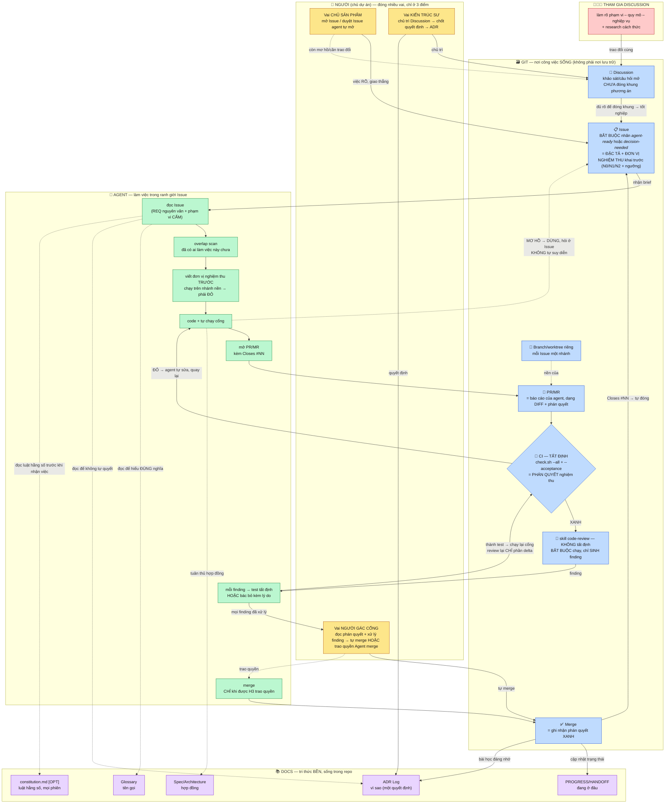
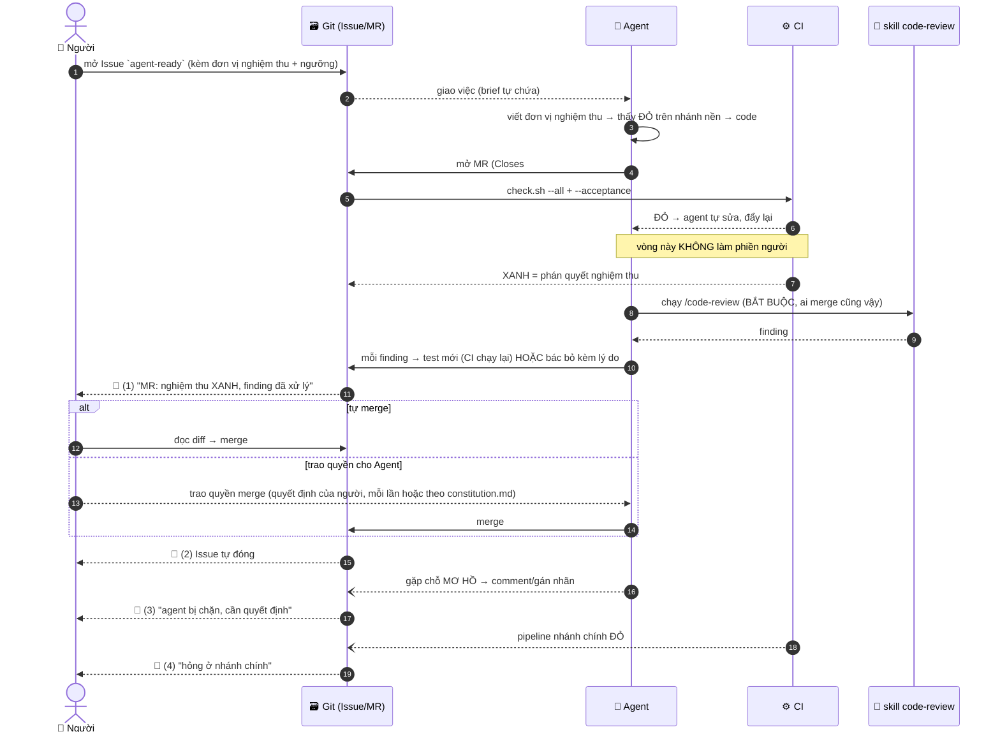

# GIT-FLOW.md — Dùng git làm hệ quản lý tài liệu & công việc (companion của CLAUDE.md)

> **File này là gì:** phần mở rộng **[OPT]** của `CLAUDE.md` — chỉ đọc file này khi project đã chọn
> phương án O7-A (git làm hệ quản lý việc, xem §11 trong `CLAUDE.md`). Tách riêng ra khỏi CLAUDE.md để
> agent không phải tải toàn bộ luồng git mỗi phiên nếu project không dùng tới.
>
> **File này PHỤ THUỘC `CLAUDE.md`:** mọi tham chiếu `§1`–`§10`, `§12` trong file này trỏ ngược về
> `CLAUDE.md` (bảy luật bất di bất dịch, cách chọn quy mô, Tier 0...). Đọc `CLAUDE.md` trước.
>
> **Mục lục:** §11b Git làm hệ quản lý tài liệu & việc (constitution.md · quy ước nhánh `agent/*` ·
> **GitHub Discussions trước khi thành Issue** · Hai mẫu Issue · run record · tách SPEC/PLAN) · §11c Hệ
> sinh thái nhiều repo (monorepo vs polyrepo · hub repo · ID cấp ECO · CI dùng chung).

---

## 11b. [OPT] Dùng chính GIT làm hệ quản lý tài liệu & công việc

Phương án O7-A đầy đủ: **Issue = kho TODO + nơi KHAI đơn vị nghiệm thu · PR = đơn vị review · phán quyết
nghiệm thu tất định XANH = chấp nhận · merge = ghi nhận sự chấp nhận đó · CI = cổng máy.** Trạng thái
sống ở nơi vốn đã có vòng đời (mở → gán → đóng), thay vì ở markdown phải nhớ cập nhật bằng tay.

**Điều kiện đảo sang O7-A:** `CLAUDE.md` §11, ngay dưới bảng O (số agent chạy đồng thời, không phải số
người). `git branch --list 'agent/*'` liệt kê đúng ai đang làm gì tại mọi thời điểm.

**Chấp nhận ≠ review ≠ merge.** Ba thứ trước đây bị gộp chung một chữ "merge = chấp nhận":
- **Nghiệm thu** — phán quyết ĐẠT/KHÔNG ĐẠT, **tất định** (cùng commit + cùng dữ liệu đóng băng ⇒ cùng
  phán quyết). Định nghĩa gốc + 3 cấp N0/N1/N2: `AGENT.md` §4.1 — không lặp lại ở đây.
- **Review** — người/LLM đọc diff, **sinh finding**. Không tất định ⇒ KHÔNG được làm phán quyết; mỗi
  finding phải được chuyển thành test tất định hoặc bác bỏ kèm lý do.
- **Merge** — thao tác ghi nhận, chỉ hợp lệ khi nghiệm thu XANH và mọi finding đã xử lý.

### Toàn cảnh: git trở thành **mặt bàn điều hành** cho cả người lẫn agent

Mô hình dưới đây **quan sát được ở một project có thật** đang chạy theo cách này (một người đóng cả ba
vai chủ sản phẩm / kiến trúc sư / người gác cổng, phần lớn code do agent AI viết). Đặc trưng của nó:
**con người không giao việc bằng chat, mà giao bằng Issue; agent không báo cáo bằng lời, mà báo cáo
bằng PR/MR; và cái gật đầu cuối cùng vẫn là của con người, tại nút merge.**



**Đọc sơ đồ này ra bảy ý:**
1. **Người (chủ dự án) chỉ chạm 3 điểm** (mở việc · chốt quyết định · merge) — phần còn lại là agent +
   máy. Đó là cách một người đóng được nhiều vai mà không vỡ.
2. **Issue là ĐẶC TẢ, không phải lời nhắc.** Viết Issue buộc người phải chốt phạm vi **trước khi** agent
   bắt đầu; agent nhận một brief tự chứa; mục "KHÔNG được đụng vào" giới hạn bán kính thiệt hại. Nhãn
   `agent-ready`/`decision-needed` là bắt buộc, không tuỳ chọn — chi tiết ở § "Hai mẫu Issue" dưới đây.
3. **TechLead, Dev, BA tham gia Discussion trực tiếp**, không phải một mình chủ dự án — chi tiết vai trò
   và mục đích ở § "GitHub Discussions" dưới đây. Việc đã rõ thì H1 giao thẳng vào Issue (mũi tên liền);
   việc còn cần bàn thì qua Discussion trước, "tốt nghiệp" thành Issue `decision-needed` khi đủ khung
   phương án (mũi tên đứt). Agent không tham gia nhánh này.
4. **Mũi tên `MƠ HỒ → DỪNG, hỏi ở Issue`** là thứ giữ cho mô hình không trôi: agent gặp chỗ chưa rõ thì
   quay lại Issue, không tự quyết. Không có mũi tên này thì Issue chỉ là hình thức.
5. **Docs không nằm trong vòng lặp thực thi — chúng là thứ vòng lặp ĐỌC và GHI vào.** Agent đọc
   Glossary/ADR để hiểu đúng nghĩa; merge ghi ngược lại trạng thái + bài học.
6. **Phán quyết chỉ đến từ cổng TẤT ĐỊNH (C).** `code-review` (RV) bắt buộc chạy nhưng nằm NGOÀI đường
   phán quyết: nó sinh finding, finding được biến thành test (rồi chính test đó phán quyết) hoặc bị bác
   bỏ kèm lý do. Chạy lại RV ra finding khác cũng không làm phán quyết đổi — chi tiết § "Năm cổng".
7. **Đơn vị nghiệm thu có trước code (A0).** Viết sau code thì nó đo cái code đã làm, không đo cái Issue
   yêu cầu; và phải thấy nó ĐỎ trên nhánh nền mới biết nó đo được thay đổi (`AGENT.md` §4.1).

### `constitution.md` — [OPT] tầng luật riêng cho agent, tách khỏi ADR Log

ADR trả lời **"vì sao một quyết định cụ thể"** — gắn với bối cảnh, có thể Superseded (L4). Nhưng có một
loại luật khác hẳn: **hằng số áp cho MỌI phiên agent, không gắn bối cảnh nào** — quy ước code style bắt
buộc, danh sách file/thư mục **cấm đụng toàn cục** (khác "phạm vi cấm" của riêng một Issue), lệnh luôn
phải chạy trước khi mở PR. Nhét loại luật này vào ADR thì mỗi ADR mới lại phải nhắc lại; nhét vào Issue
thì lặp N lần. Một file `constitution.md` cạnh Tier 0, agent đọc nó y như đọc Glossary/ADR (thêm một ô
D5 vào subgraph DOCS ở trên), sửa qua PR như tài liệu thường (Loại 1/2 ở L4 — bổ sung/sửa lỗi, không cần
ADR trừ khi đảo ngược một luật đã có).

**Khi nào cần [TRIGGER]:** agent bắt đầu **lặp lại cùng một lỗi phạm vi/style ở nhiều Issue khác nhau** —
dấu hiệu luật đó thuộc về mọi phiên, không thuộc về một quyết định. **Chưa cần:** ADR nền tảng (L1) đang
đủ, ít agent-session, project mới ở mức S.

### Người được ĐÁNH THỨC lúc nào — cơ chế thông báo

Điểm tinh tế: người **không ngồi canh** agent. Nền tảng git đã có sẵn cơ chế báo; việc cần làm là bố trí
để nó chỉ kêu ở đúng 4 thời điểm — nhiều hơn thì bị nhiễu, ít hơn thì mất kiểm soát.

*Phạm vi sơ đồ dưới đây bắt đầu từ Issue `agent-ready` đã sẵn sàng — KHÔNG bao gồm giai đoạn Discussion
(hội thoại thuần người, chưa có agent, không có sự kiện CI nào để báo — xem sơ đồ tổng ở trên).*



| # | Đánh thức khi | Vì sao đáng làm phiền |
|---|---|---|
| 1 | Nghiệm thu XANH + mọi finding đã xử lý, chờ merge | Người duyệt các finding bị BÁC BỎ (chỗ duy nhất còn phán đoán) + quyết tự merge hay trao quyền |
| 2 | Issue tự đóng | Xác nhận vòng đã khép, không cần theo dõi tay |
| 3 | **Agent bị chặn / gặp chỗ mơ hồ** | Quan trọng nhất: thà bị đánh thức còn hơn để agent tự suy diễn |
| 4 | Pipeline nhánh chính đỏ | Hỏng thứ đang chạy — khẩn |

★ Thông báo (1) chỉ nổ khi phán quyết XANH và không còn finding bỏ trống — báo sớm hơn là gọi người tới
xem một MR còn dở, đúng thứ 4-thời-điểm này cố tránh.

★ **KHÔNG** báo khi: agent đang code · CI đỏ ở nhánh feature (agent tự sửa) · mỗi commit. Báo mọi thứ =
người tắt thông báo = mất luôn cả 4 cái quan trọng.

### Điều kiện tiên quyết — làm SAI thứ tự là tự chặn đường
> **`make check` chạy được ở máy → CI chạy được `make check` → RỒI MỚI khoá nhánh + bắt buộc MR.**

Áp nghi lễ MR khi CI chưa chạy thì "merge = đã qua test" chỉ là lời tuyên bố — đúng thứ L5 cấm, và tệ
hơn không áp vì nó tạo cảm giác an toàn giả.

### Kích hoạt O7-A giữa chừng một project đang chạy O7-B

Áp dụng khi project đã có nội dung thật ở O7-B (roadmap `§TODO` đang chứa việc đang mở, không phải file
rỗng) và vừa đạt điều kiện đảo (≥2 agent chạy đồng thời, `CLAUDE.md` §11). Thứ tự, không đảo bước:

1. **Kiểm Issue tracker sạch trước khi chuyển:** `gh issue list --state all -R <owner>/<repo>`. Có Issue
   cũ đang mở từ trước ⇒ xử lý/đóng trước, tránh nhầm giữa "đã có sẵn từ khi khác" và "mới mở do chuyển
   đổi lần này".
2. **Ghi quyết định bằng một ADR** (`ADR-<PROJ>-NNN`, hoặc `ADR-ECO-NNN` nếu ảnh hưởng ≥2 repo, §11c) —
   Nygard, liệt kê rõ phương án bị loại và vì sao (không chỉ phương án được chọn).
3. **Đảo O2 cùng lúc nếu `adr-log.md` đang là một file** — cùng nguyên nhân concurrency, không phải hai
   quyết định độc lập. Tách thành `adr-log/`, một file/ADR (tên `ADR-<PROJ>-NNN-<slug>.md`, ID là định
   danh thật theo L3, slug chỉ để lướt thư mục) + một `README.md` làm index. Sau khi tách: `grep -rn
   "adr-log\.md"` trên toàn repo, sửa **mọi** file trỏ tới đường dẫn cũ — không chỉ file gọi trực tiếp.
4. **Dựng scaffolding trước khi mở Issue đầu tiên:** `.github/ISSUE_TEMPLATE/{agent-ready,decision-
   needed}.yml` + `PULL_REQUEST_TEMPLATE.md` (mẫu ở `templates/`/`.github/` cạnh file này). Tạo label
   `agent-ready`/`decision-needed` nếu repo chưa có (`gh label create`) — `gh issue create --label` báo
   lỗi nếu label chưa tồn tại.
5. **Migrate JIT (just-in-time) cho việc CHƯA làm, không dump toàn bộ backlog.** Một mục `§TODO` chưa
   đóng chỉ được viết thành Issue thật khi điền đủ các trường bắt buộc của `agent-ready.yml` (kể cả đơn vị
   nghiệm thu) **và**
   sắp được cầm lên làm — không mở Issue thô hàng loạt trước cho cả backlog (Issue là ĐẶC TẢ, viết TODO
   nguyên văn vào Issue không đạt chuẩn đó). `roadmap.md`/`§TODO` cũ đổi vai trò thành backlog + sổ lịch
   sử. Mục **đã đóng** trước ngày chuyển không bắt buộc có Issue, nhưng mở Issue rồi đóng ngay lúc tạo
   (kèm link commit/verify trong phần đóng) là hợp lệ khi muốn có trace GitHub đầy đủ cho một cụm việc có
   Issue anh em còn mở — không phải việc thừa, miễn giữ đúng nhãn "retroactive" trong nội dung Issue để
   không ai đọc nhầm thành việc đang chờ làm.
6. **Seed 1–2 Issue thật trước khi coi bước này xong.** Dựng khung (bước 4) mà chưa mở Issue nào là chưa
   chứng minh luồng chạy được — `gh issue create` thật, không phải bản nháp trong đầu.
7. **Sau khi seed, quét lại con trỏ cũ.** Mọi chỗ trong docs từng trỏ vào mục `§TODO` vừa migrate phải
   đổi thành link Issue thật (`→ Issue #N`), không giữ cả hai cùng là "nguồn việc-đang-mở" (L2). Đồng
   thời rà các số liệu liên quan đã đổi cùng thời điểm nhưng nằm ở file khác (vd một bảng đếm số test-đỏ
   ở file A không tự cập nhật khi test được sửa ở file B) — quét bằng cách tìm mọi chỗ trích dẫn cùng
   con số/đường dẫn vừa đổi, không chỉ sửa nơi trực tiếp liên quan đến thay đổi.

### Chia việc giữa Issue và Docs — giữ L2 (một loại sự thật, một nhà)
Thêm Issue mà vẫn giữ bảng TODO trong docs = **hai nguồn sự thật**. Chia theo **tuổi thọ thông tin**:

| Loại thông tin | Nhà | Vì sao |
|---|---|---|
| Việc **đang mở**, trạng thái, ai làm, chặn bởi gì | **Issue** | Vòng đời ngắn, có sẵn cơ chế đóng/gán/lọc |
| **Vì sao** quyết định thế, bất biến, bài học, cơ chế | **Docs (ADR/algorithm/testing)** | Đáng đọc lại sau 6 tháng; Issue đóng rồi không ai lục |
| Lịch sử "đã sửa gì" | **`git log` + MR đã merge** | Đừng chép lại vào docs |

Nối hai chiều: Issue trỏ mục doc liên quan; doc ghi bài học kèm số Issue. Mỗi loại vẫn đúng một nhà.

### [OPT] Quy ước tên nhánh cho agent — `agent/<issue-id>-<slug>`

Ví dụ: `agent/42-fix-quota-closure-bug`. Tiền tố `agent/` (hoặc `ai/`, miễn nhất quán) làm hai việc:
báo cho reviewer **trước khi mở diff** đây là code máy viết, và cho phép áp **branch-protection riêng**
cho nhánh agent (vd bắt buộc CI xanh, cấm force-push) khác với nhánh người. Lợi ích đo được:
`git branch --list 'agent/*'` liệt kê đúng và chỉ đúng mọi nhánh agent đang mở.

★ Cộng đồng đang chia phe về việc có nên đánh dấu **từng dòng** do agent viết trong `git blame` hay
không — phe cho rằng ai commit thì người đó chịu trách nhiệm, không cần nhãn theo dòng. Quy ước **theo
nhánh** ở trên tránh được tranh cãi này: nhãn nằm ở cấp quy trình (branch/PR), không nằm ở cấp dòng code.

### Năm cổng, theo thứ tự tăng dần chi phí

| Cổng | Nội dung | Tất định? | Chi phí | Đáng làm khi |
|---|---|---|---|---|
| G1 **`check.sh --all` + `--acceptance`** | lint · typecheck · import-linter · test/smoke + **mọi đơn vị nghiệm thu** (`AGENT.md` §4) | ✅ — **đây là phán quyết** | thấp | luôn luôn |
| G2 **CI chạy G1** | mỗi push/MR | ✅ | thấp (nếu có runner) | luôn luôn |
| G3 **Nhánh được bảo vệ** | cấm push thẳng; merge khi pipeline xanh | ✅ | trung bình | sau khi G2 ổn định |
| G4 **skill `code-review`** | **BẮT BUỘC chạy trước MỌI merge** (chốt 2026-09-13), ai bấm merge cũng vậy. Vai trò: **sinh finding**, KHÔNG phán quyết. Mỗi finding → test tất định (vào G1) hoặc bác bỏ kèm lý do trong PR | ❌ — nên không được chặn trực tiếp | thấp | luôn luôn |
| G5 **Người duyệt** | approvals/CODEOWNERS, cấm tự merge | ❌ | cao | **[TRIGGER]** ≥2 người thật |

★ **Vì sao G4 không được làm cổng chặn trực tiếp:** chạy `/code-review` hai lần trên CÙNG diff có thể ra
hai bộ finding khác nhau ⇒ "PR này đạt chưa?" phụ thuộc vào lần chạy nào — đúng thứ nghiệm thu tất định
cấm. Chuyển finding thành test giữ được giá trị phát hiện của G4 mà phán quyết vẫn tất định, và lần sau
test đó còn chặn hồi quy — finding chỉ nói một lần, test nói mãi. Finding không thể thành test (vd đặt
tên, độ rõ ràng) → bác bỏ hoặc sửa, kèm một dòng lý do; người gác cổng duyệt các dòng bác bỏ đó.
**Điểm dừng:** sau khi sửa finding, review lại **chỉ phần delta** (commit thêm kể từ lần review trước) —
chạy lại toàn diff thì một bộ chấm không tất định sẽ sinh finding mới mãi, PR không bao giờ tới H3.

★ Một mình thì G5 là **tự-review**, không phải review độc lập — đừng gọi tên sai bản chất. G4 không thay
thế G5 và ngược lại.

**Sau G1–G4, người gác cổng (H3) chọn:** tự merge, hoặc **trao quyền cho Agent merge** (A5) — cấp từng lần
hoặc cho cả loại Issue, ghi ở `constitution.md` § "Trao quyền merge cho Agent".

### [OPT] GitHub Discussions — trước khi thành Issue

**Đối tượng tham gia:** TechLead, Dev, BA join trực tiếp vào thread — không phải một mình chủ dự án tự
hỏi tự trả lời. **Mục đích:** làm rõ phạm vi – quy mô – nghiệp vụ, và research cách thức, trước khi đóng
khung thành phương án. Mời đúng vai theo câu hỏi: TechLead (kiến trúc/khả thi kỹ thuật), BA (nghiệp
vụ/phạm vi), Dev (chi phí hiện thực hoá) — thiếu một vai dễ ra quyết định lệch góc nhìn.

**Vì sao KHÔNG dùng thẳng Issue cho mọi thứ:** một `decision-needed` Issue (§ "Hai mẫu Issue" dưới đây)
giả định bối cảnh đã đủ gọn để đóng khung thành phương án + quyết định — đúng hình dạng một ADR nháp.
Nhưng nhiều thứ cần trao đổi **CHƯA** ở dạng đó: một audit/khảo sát dài, một câu hỏi mở còn nhiều hướng,
một phát hiện cần ý kiến nhiều phía trước khi biết nên đóng khung quyết định thế nào. Nhét thẳng vào
Issue ép người đọc phải phản hồi bằng thao tác Issue (đóng/gán/label) cho một thứ còn đang **hình thành
ý** — sai công cụ. GitHub Discussions đúng vai trò này: threaded, không có trạng thái mở/đóng ép buộc,
được thiết kế cho hội thoại nhiều lượt.

**Phễu (funnel) — đừng bỏ bước nào:**
```
Discussion (mở, khảo sát + câu hỏi, CHƯA đóng khung phương án)
   → owner/nhiều bên trao đổi ngay trong thread
   → khi đã đủ rõ để đóng khung "phương án nào, chọn gì" → mở Issue `decision-needed`
     LINK NGƯỢC về Discussion (không copy nội dung — L2 SSOT, xem CLAUDE.md §1)
   → Issue đó thành ADR khi merge (§ "Hai mẫu Issue" dưới đây)
```
Nếu một Discussion không bao giờ cần bước 3 (thuần thông tin, không cần quyết định gì) — cứ để nó đứng
yên ở đó, không phải mọi Discussion đều phải "tốt nghiệp" thành Issue.

**Bật Discussions:** tắt theo mặc định trên repo mới.
```bash
gh api -X PATCH repos/<owner>/<repo> -f has_discussions=true
```
hoặc Settings → General → Features → Discussions trên GitHub UI.

**Chọn category** (mặc định GitHub tạo sẵn 6 category, đừng bịa thêm category tuỳ ý — phân mảnh nơi tìm):
| Category | Dùng khi |
|---|---|
| **Ideas** | Khảo sát/audit + câu hỏi mở cần owner quyết hướng (đúng use-case của mục này) |
| **Q&A** | Câu hỏi có MỘT câu trả lời đúng, đóng khi trả lời xong (GitHub tự đánh dấu "answered") |
| **General** | Trao đổi không rơi vào nhóm nào khác |
| **Announcements** | Chỉ maintainer đăng — thông báo một chiều |
| **Polls** | Cần biểu quyết nhanh giữa vài phương án |
| **Show and tell** | Khoe demo/kết quả, không cần hành động gì tiếp |

**Hệ nhiều repo (`§11c` CLAUDE.md) — chọn MỘT nơi host, đừng bật khắp nơi:** bật Discussions trên mọi
repo trong một hệ sinh thái tạo đúng lỗi L2 (một loại sự thật, nhiều nhà) mà `CLAUDE.md` §1 cấm — người
sau không biết thảo luận về X nằm ở repo nào. Chọn theo cùng logic "repo hub giữ Tier 0" (`GIT-FLOW.md`
§11c "Một repo hub"): nếu có repo hub tài liệu riêng → host ở đó; nếu không, host ở repo **trung tâm nhất
theo luồng người dùng** (thường là repo phục vụ/điều phối, không phải repo lưu trữ dữ liệu thô) — ghi lựa
chọn này vào `docs/README.md` như mọi quyết định [OPT] khác.

**KHÔNG dùng Discussions cho:** việc code được ngay (đi thẳng `agent-ready` Issue) · sự thật đã chốt
(Glossary/ADR — Discussions không có ID bất biến, đừng trích dẫn nó như một nguồn sự thật lâu dài, xem
L3) · một thread ngày càng dài không ai còn nhớ kết luận — nếu tới mức đó, tóm tắt thành comment ghim
(pin) hoặc tách Issue, đừng để Discussion tự phình thành tài liệu thay thế ADR.

### Hai mẫu Issue đủ dùng

**Bắt buộc, không tuỳ chọn:** mọi Issue mang ít nhất một trong hai nhãn dưới đây — không nhãn thì không
phải hàng đợi việc hợp lệ. Tạo qua `.github/ISSUE_TEMPLATE/{agent-ready,decision-needed}.yml` thì tự gắn
sẵn; tạo tay (`gh issue create` không qua template, hoặc import/retroactive) phải gắn ngay lúc tạo
(`gh issue edit <N> --add-label agent-ready`), không để trống rồi tính sau.

- **`decision-needed`** → đầu vào của một ADR. Bắt buộc: bối cảnh · các phương án · thứ **KHÔNG** thuộc
  phạm vi quyết định này. Đóng khi ADR merge. **Trước khi liệt kê phương án:** research web (học thuật +
  industry) TỰ ĐỘNG, không đợi được nhắc — xem `AGENT.md` §8. Danh sách phương án chỉ từ suy luận nội
  bộ, chưa đối chiếu tiền lệ ngành, là danh sách CHƯA ĐỦ để đưa cho owner quyết.
- **`agent-ready`** (Story) → việc code được ngay. Tách **hai khối bên trong Issue**, vì độ bất biến khác
  nhau (áp dụng khi Issue đủ phức tạp để "cách làm" có thể sai dù "yêu cầu" đúng — Issue nhỏ giữ gộp
  như cũ):
  - **SPEC (bất biến trong phiên):** yêu cầu **trích nguyên văn** từ tài liệu nguồn (không diễn giải lại
    — paraphrase là nơi hiểu sai chui vào) · vị trí file · **đơn vị nghiệm thu: cấp N0/N1/N2 + lệnh +
    kết quả/ngưỡng mong đợi** (`AGENT.md` §4.1 — "chạy thử thấy ổn" không phải tiêu chí) · **phạm vi
    KHÔNG được đụng** · **Blocked by**.
  - **PLAN (agent điền, SỬA ĐƯỢC giữa chừng):** cách làm dự kiến · thứ tự bước · file dự kiến đụng tới.
    Cách làm sai thì sửa PLAN và ghi lại vì sao; **không** đóng Issue viết lại từ đầu, vì SPEC vẫn đúng.

★ **Overlap scan trước khi code** (2 phút, thủ công): liệt kê 2–3 Issue gần nhất cùng nhóm, xem có ai
đang làm cùng một bài toán không. *Tiền lệ thật:* hai Story song song viết **hai hàm độc lập cho cùng
một việc**, chỉ lộ ra sau khi cả hai đã merge.

### [OPT] Run record trong PR/MR — nhật ký phiên chạy của agent

Mô tả PR/MR do agent mở nên có thêm, ngoài `Closes #NN`: **quyền công cụ** agent được cấp trong phiên đó
(đọc/ghi file, network, shell) · **model + version** đã dùng · **ngoại lệ chính sách** nếu có (vd được
phép bỏ qua một rule lint cụ thể). Không phải để trang trí — khi có sự cố, câu cần trả lời là *"agent
được phép làm gì lúc đó"*, không phải chỉ *"agent đã làm gì"* (cái sau đã có sẵn trong diff).

**Khi nào cần [TRIGGER]:** agent có quyền **thực thi thật** (chạy shell, gọi network, không chỉ sửa
file tĩnh). **Chưa cần:** agent chỉ có quyền đọc/sửa file trong sandbox, không có quyền thực thi ngoài
`make check`.

### Nếu nền là GitLab (không phải GitHub) — bảng quy đổi
| GitHub | GitLab | Lưu ý |
|---|---|---|
| Pull Request | **Merge Request** | `Closes #NN` vẫn tự đóng Issue |
| Discussions (độc lập, xem § "GitHub Discussions" ở trên) | **không có** | Dùng Issue gắn nhãn `discussion`, đóng thủ công khi tốt nghiệp thành `decision-needed` |
| Issue Forms (`.yml`, có trường cấu trúc) | `.gitlab/issue_templates/*.md` | Chỉ markdown — không có trường bắt buộc |
| PR template | `.gitlab/merge_request_templates/*.md` | |
| Actions | `.gitlab-ci.yml` | **Kiểm có runner trước** (Settings → CI/CD → Runners) |
| `gh` CLI | `glab` CLI | Không có sẵn thì agent không thao tác được Issue/MR |
| Branch protection + required review | Protected branches (có ở bản free); **approval rules/CODEOWNERS ép buộc thường là bản trả phí** | Kiểm tier trước khi thiết kế quy trình dựa vào chúng |

### Bảng quyết định điển hình khi dựng cổng lần đầu (làm gì · quyết gì · vì sao)

Đây là **các quyết định đã thực sự phải ra** khi lắp bộ này vào một hệ nhiều repo, kèm lý do. Ghi lại để
lần sau không phải nghĩ lại từ đầu. Bối cảnh gốc: 3 repo Python cùng một nhóm, chạy bằng
`docker compose`, GitLab tự dựng (self-hosted).

| Quyết định | Chọn gì | Vì sao |
|---|---|---|
| **Script hay Makefile** | một `scripts/check.sh` | Máy dev/run **không có `make`**; cài thêm gói hệ thống là đổi hạ tầng, không làm lặng lẽ. Vai trò y hệt; nếu sau này có `make` thì `check: ; ./scripts/check.sh` |
| **Runner: cài bằng apt hay chạy bằng docker** | **docker** (ảnh runner chính thức) | Gỡ sạch bằng `compose down` + xoá volume, không để lại systemd unit hay binary lạc. Máy vốn đã docker-first |
| **Runner đặt ở thư mục nào** | cùng chỗ với **hạ tầng dùng chung sẵn có** (vd thư mục đang chứa stack observability) | Đi theo tiền lệ đã có trong repo thay vì mở quy ước mới; hạ tầng dùng chung cả nhóm repo thì để một chỗ |
| **Cấp đăng ký runner** | **cấp GROUP**, không phải từng project | Một runner phục vụ mọi repo trong nhóm, khỏi dựng lại N lần |
| **CI chạy gì** | gọi **đúng script mà người chạy ở máy** | Một nơi định nghĩa, hai nơi gọi. Viết lại logic kiểm trong YAML là nguồn kinh điển của "máy tôi xanh mà CI đỏ" |
| **CI chạy tầng nào** | **chỉ tầng TĨNH** | Máy CI không có hạ tầng của app (DB, message bus, dịch vụ mô hình). Smoke vẫn chạy ở máy dev qua `--smoke`. Công cụ kiểm tĩnh chỉ đọc AST ⇒ chạy được trong image trống |
| **Bật bao nhiêu luật lint** | **chỉ nhóm bắt lỗi thật** (lỗi cú pháp · so sánh sai · dùng tên chưa định nghĩa) | Bật cả bộ ra **337 lỗi**, phần lớn là style ⇒ cổng đỏ-sẵn → người ta tắt đi → mất luôn tác dụng. Nhóm hẹp đang xanh **và** bắt được lỗi thật (xem ngay dưới) |
| **Bí mật (token) đi đường nào** | qua **tệp**, không qua chat/tham số dòng lệnh | Chat và lịch sử shell đều lưu lại vĩnh viễn. Script không in token ra, và bắt xoá tệp ngay sau khi dùng |

★**Cổng vừa dựng đã bắt được bug thật ngay hôm đầu** — lý lẽ mạnh nhất cho việc dựng cổng. Luật lint
"dùng tên chưa định nghĩa" chỉ ra một closure ôm biến của khối `except` (Python `del exc` ngầm khi ra
khỏi khối, closure chạy lúc stream ⇒ `NameError` thay vì thông báo hết quota). Sống nhiều tháng, mọi test
xanh. Đã tái hiện bằng 8 dòng trước khi vá. Cùng mã lỗi nhưng một chỗ khác chỉ là annotation biến cục bộ
(không đánh giá lúc chạy) — **đừng báo cáo lỗi thật và lỗi hình thức cùng một giọng**.

**Dựng cổng cũng phải kiểm cổng** — bốn lỗi của chính cổng đã gặp:
- **(1) Cổng tự tạo rác rồi tự vấp** (`__pycache__` → module ma) và **(2) thông báo có tác dụng phụ**
  (backtick trong nháy kép chạy thật lệnh cài) — cả hai đã **ép bằng máy** trong `scripts/check.sh`
  (comment đầu file), không nhắc lại ở đây (L7).
- **(3)** `./check.sh | tail -2 && git commit` — exit code của pipeline là của `tail` ⇒ commit chạy dù
  cổng ĐỎ. Đừng bọc cổng trong pipeline, hoặc bật `set -o pipefail`.
- **(4) Xanh vì skip toàn bộ.** Đo ngày 2026-11-23 trên chính repo playbook này: CI báo `success` 5/5
  lần chạy gần nhất (`gh run list -L 5`), `check.sh --all` cho `pass=0 fail=0 skip=4` — xanh mà không
  kiểm gì. Vì vậy ở `--acceptance`: đơn vị đã khai mà không chạy được (exit 77) là ĐỎ, PR đóng Issue mà
  thiếu đơn vị là ĐỎ; chỉ "repo chưa có đơn vị nào" là SKIP-kèm-cảnh-báo (`AGENT.md` §4.2).

### Khi KHÔNG có runner / KHÔNG đủ quyền — vẫn lấy được phần lớn giá trị

**Cách kiểm "có runner không" mà không cần quyền gì:** push một `.gitlab-ci.yml` tối giản rồi nhìn
Pipelines. Job mang nhãn **`stuck`** + `Pending` ⇒ **không có runner** (job tạo ra nhưng không ai nhận).
Đây là kiểm nghiệm thực chứng — hơn hẳn việc đoán qua menu.

★**Một trường hợp có thật đáng nhớ:** trong lịch sử pipeline của repo có một job hỏng từ **hai tháng
trước**, ai cũng tưởng là lỗi code nên không ai đụng tới. Đọc kỹ thì nó cũng chỉ mang nhãn `stuck` rồi
hết giờ chờ — tức là **chưa từng có runner nào**, code chưa hề được chạy lấy một lần. Bài học: *nhãn
trạng thái của pipeline là dữ liệu chẩn đoán, đọc nó trước khi kết luận về code.*

**Cách biết mình có quyền dựng runner không:** trong GitLab, mục **`Settings`** ở sidebar **chỉ hiện với
Maintainer/Owner**. Sidebar đi thẳng từ `Analyze` → `Help` mà không có `Settings` ⇒ đang là Developer.
Chắc chắn hơn thì mở thẳng `/-/settings/ci_cd` — 404/403 là câu trả lời.

**Phương án không cần quyền: git hook `pre-push`** gọi đúng `scripts/check.sh`.

| | CI (có runner) | Hook `pre-push` |
|---|---|---|
| Bản chất | **cưỡng chế** | **kỷ luật** |
| Bỏ qua được? | không (nếu khoá nhánh) | có — `--no-verify` |
| Người mới clone | tự động có | **phải tự chạy** `install-hooks.sh` (git không version `.git/hooks`) |
| Chạy tầng nào | tĩnh | tĩnh (**cố ý**: push chậm ⇒ người ta `--no-verify` cho xong, cổng mất tác dụng) |

★Nói rõ giới hạn **ngay trong file hook**. Một cổng bị hiểu nhầm là cưỡng chế trong khi thực ra bỏ qua
được thì còn nguy hơn không có cổng.

### Chi phí thật, nói trước
Thay đổi đắt nhất **không phải công cụ** mà là **thói quen nhánh**: từ nhánh cá nhân dài hạn
(`dev-<tên>`, push thẳng) sang nhánh feature ngắn cắt từ mainline. Chưa sẵn sàng đổi thói quen đó thì
làm G1+G2 trước — đã lấy được phần lớn giá trị mà chưa phải đổi cách làm việc.

---

## 11c. [OPT] Hệ sinh thái nhiều repo — khi §11b phải trải ra trên >1 repo

★ **Cảnh báo mức bằng chứng (theo L6 ở CLAUDE.md):** khác với §11b — vốn mô tả một hệ thống đang chạy
thật — mục §11c này là **tổng hợp từ khảo sát thực hành ngành + suy luận logic**, chưa có xác nhận đã
chạy đúng nguyên trạng trong một project cụ thể. Áp dụng thật thì tự thêm dòng "đã verify ngày <DATE>"
theo L5, đừng đọc nó với cùng mức tin cậy như phần quan sát được.


**[TRIGGER] kích hoạt mục này khi:** ≥2 trong số các repo **thật sự phụ thuộc lẫn nhau** — đổi API/schema
ở repo này thường kéo theo việc phải đổi ở repo kia. **Chưa cần** nếu 3 project chỉ tình cờ cùng một
người quản lý nhưng độc lập hoàn toàn (không gọi nhau, không chia schema) — lúc đó áp §11b riêng cho
từng repo là đủ, đừng phức tạp hoá.

### Bước 0 — quyết định monorepo hay polyrepo, và **ghi lại như một ADR**

Đây không phải câu hỏi công cụ, mà là đánh đổi thật, và nên trace được như mọi quyết định khác (L1–L4):

| | Monorepo (gộp 3 vào 1 repo) | Polyrepo (giữ 3 repo riêng) |
|---|---|---|
| Agent thấy được gì | Toàn bộ 3 project trong một context — sửa xuyên repo trong **một PR** | Agent ở repo A không thấy ai đang tiêu thụ code nó vừa sửa; đổi xuyên repo cần điều phối thêm |
| Chi phí hạ tầng | Phải đầu tư liên tục (build cache, CI phân vùng theo thư mục) theo kịp quy mô, không thì PR review time giãn ra không đoán được | Mỗi repo tự chủ CI/release riêng, chi phí hạ tầng thấp hơn nhưng đổi xuyên repo cần N PR đồng bộ |
| Hợp khi | 3 project phụ thuộc chéo nhiều, đổi thường kéo cả 3, bạn là người/agent duy nhất vận hành | 3 project release lệch nhịp nhau, sau này có thể tách quyền truy cập/đội ngũ riêng cho từng cái |
| Không hợp khi | Bạn chưa sẵn sàng đầu tư tooling build/CI phân vùng — monorepo không tự nhiên rẻ | 3 project đổi API cùng lúc thường xuyên — chi phí điều phối N-PR ăn hết lợi ích tách repo |

★ Mặc định đề xuất cho "một người + agent, 3 project phụ thuộc chéo, tốc độ cao": **monorepo** — agent
sửa xuyên 3 project trong một PR, một `make check` chạy được cả 3. Đổi ý sau này (tách ra) vẫn dễ hơn
chiều ngược lại.

Nếu chọn polyrepo, phần dưới đây áp dụng.

### Một repo "hub" giữ Tier 0 — các repo code chỉ LINK, không copy

Vi phạm L2 điển hình khi có nhiều repo: mỗi repo tự có một bản `glossary.md`/`adr-log.md` riêng, rồi
lệch nhau dần. Xử lý: tạo một repo thứ 4 (`<eco>-docs`), chuyển toàn bộ Tier 0 — `glossary.md`,
`adr-log.md`, `context-map.md`, `constitution.md` (§11b), `README.md` (Doc Index) — về đó. Mỗi repo code
chỉ giữ một file mỏng trỏ sang:

```markdown
<!-- docs/POINTER.md trong từng repo con -->
Tài liệu nền tảng của hệ sinh thái sống ở <eco>-docs, KHÔNG lặp lại ở đây:
- Glossary: <link> · ADR Log: <link> · Context Map: <link> · Constitution: <link>
Tài liệu CHỈ RIÊNG repo này (algorithm.md, interface.md...) vẫn ở docs/ như bình thường.
```

**Context Map đổi vai trò:** trước đây (1 repo) nó vẽ ranh giới với thế giới ngoài; giờ nó vẽ **ranh
giới giữa 3 project của chính bạn** — cái gì thuộc repo nào, ai gọi ai, qua hợp đồng nào (Interface
Control Document — Tier 2/3, không còn là tuỳ chọn ở mức M, xem §4).

### ID cấp hệ sinh thái — thêm một tầng, không thay tầng cũ

`GLOSS-<PROJ>-001` chỉ có nghĩa trong phạm vi 1 project. Thêm tầng `GLOSS-ECO-001` cho thuật ngữ **dùng
chung cả 3** (tên miền nghiệp vụ, thực thể xuyên repo); giữ nguyên `GLOSS-<PROJ>-001` cho thuật ngữ chỉ
riêng 1 repo. Cùng quy tắc cho `ADR-ECO-*` (quyết định ảnh hưởng ≥2 repo, vd chọn giao thức giữa các
service) so với `ADR-<PROJ>-*` (quyết định nội bộ 1 repo).

### Issue liên-repo — `Closes owner/repo#N` phải viết rõ, không tự nhiên hoạt động

`Closes #NN` trong PR chỉ tự đóng Issue **cùng repo**. GitHub hỗ trợ `Closes owner/repo-khac#12` để đóng
Issue ở repo khác, nhưng nếu không quy ước rõ trong template `agent-ready`, Issue liên-repo sẽ bị quên.
Thêm một trường bắt buộc vào SPEC (§11b) khi việc động tới >1 repo: **"Repo liên quan"** — liệt kê hết,
mỗi repo một Issue riêng, trỏ nhau bằng `Blocked by owner/repo#N` / `Blocks owner/repo#N`.

### CI dùng chung — reusable workflow, không copy-paste YAML

Tương đương "runner cấp GROUP" đã nói cho GitLab (§11b): trên GitHub, đặt `scripts/check.sh` (G1) và
workflow gốc trong repo hub hoặc một repo `.github` cấp tổ chức, 3 repo con gọi lại bằng:
```yaml
jobs:
  check:
    uses: <org>/<eco>-docs/.github/workflows/check.yml@main
```
Một nơi định nghĩa cổng, ba nơi gọi — đúng nguyên tắc "CI chạy đúng script mà người chạy ở máy" (bảng
quyết định ở §11b), chỉ mở rộng từ 1 repo ra N repo.

### Khi nào tính lại quy mô S→M

Có hệ sinh thái ≥2 repo phụ thuộc chéo là điều kiện "domain thứ 2 sắp lên" trong bảng §2 đã xảy ra thật
— tự động đẩy quy mô tài liệu từ **S lên M**: Tier 0 tách file hẳn (không gộp như mức S nữa), PR review
bắt buộc cho `docs/**` ở repo hub, Doc Index có trạng thái Draft/In Review/Approved.

---

